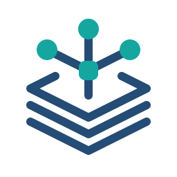

<div align="center">
  <picture>
    <source media="(prefers-color-scheme: dark)" srcset="docs/assets/brand/logo-dark.svg">
    
  </picture>
  <h1>Personal Agent Foundation</h1>
  <p><strong>让你的规则、项目与工作经验，跟随你使用的 Agent。</strong></p>
  <p>可安装 · 可迁移 · 可恢复 · 可扩展的个人 Agent 工作基座</p>
  <p>
    <a href="https://github.com/DongLiStudio/personal-agent-foundation/actions/workflows/test.yml"></a>
    <a href="LICENSE"></a>
    
    <a href="https://github.com/DongLiStudio/personal-agent-foundation/stargazers"></a>
  </p>
  <p><a href="#快速开始">快速开始</a> · <a href="docs/getting-started.md">完整使用指南</a> · <a href="#恢复与更新">恢复与更新</a> · <a href="#参与贡献">参与贡献</a></p>
</div>

---

## 为什么需要个人 Agent 基座？

换一个 Agent、开启新会话或切换项目，往往意味着重新解释规则、寻找资料、确认账号、安装工具。Personal Agent Foundation 将这些长期信息组织成由你掌握的工作目录，让兼容的 Agent 读取同一套规则、项目入口与能力说明。

它提供公开脱敏模板、对话式安装 Skill，以及现有基座的恢复和保护性更新流程。个人内容继续留在你的工作目录或原系统中，不需要提交到本仓库。

> 当前公开工程基线与跨平台自动化验证已完成；真实新电脑的账号授权及不同宿主黑盒验收仍在推进，尚未发布首个正式 Release。宿主兼容性以实际验收为准。

## 核心能力

| 能力 | 解决的问题 |
| --- | --- |
| GLOBAL 治理层 | 集中长期规则、项目索引、身份路由与安全边界 |
| 项目制上下文 | 每个项目保留独立 AGENTS、README、STATUS 与任务资料，继承公共规则 |
| 可复用 Skills | 记录能力来源与依赖，按任务读取，支持恢复安装副本 |
| 多账号身份路由 | 操作前明确飞书、GitHub、Gitee、云平台及邮箱身份 |
| 知识库连接 | 将 Obsidian 作为默认只读的外部知识入口，适配现有目录 |
| 服务器治理 | 使用明确 Profile 与可信主机指纹，人工 SSH 默认由 Bitwarden Agent 签名 |
| 恢复与保护性更新 | 先审计、展示计划，再备份、执行、验证和回滚 |

适合希望多个项目共享长期约定、通过对话配置工具、并在更换设备或 Agent 时保留工作方式的用户。它是工作基座，不是独立聊天应用；Agent 宿主需能读取文件、执行本地工具并请求必要授权。

## 快速开始

把下面这段话交给你的 Agent：

```text
请安装这个个人 Agent 基座：
https://github.com/DongLiStudio/personal-agent-foundation
```

Agent 会读取仓库中的 `skills/install-agent-scaffold/SKILL.md`，推荐一个新的空 Agent 根目录，检查 Python 3.11+，展示安装计划和 dry-run；得到你的明确确认后才写入文件，再逐项引导连接、个性化和首项目使用。

你主要需要决定根目录、时区和默认助手项目名。不要把密码、token、私钥或恢复码发到聊天中；账号连接使用对应官方授权流程。

完整步骤与门禁见 [使用指南](docs/getting-started.md) 和 [安装契约](docs/installation-contract.md)。已有内容的目录不会被首次安装器覆盖或合并。

## 安装后得到什么？

```text
Agent/
├── GLOBAL/                   # 公共治理、身份路由、项目索引
│   └── .agents/skills/       # 能力源稿与恢复、更新入口
├── 通用助手/                # 示例名称，可自定义
│   ├── AGENTS.md            # 工作规则与授权边界
│   ├── README.md            # 项目定位与资料入口
│   └── STATUS.md            # 当前事实、阻塞与下一步
└── 你的业务项目/            # 独立上下文与版本历史
```

GLOBAL 和具体项目同级。长期公共约定进入 GLOBAL，项目任务进入各自项目，外部知识库保持独立。

## 连接与生态

安装会完整告知并逐项确认九类连接：**飞书、GitHub、Obsidian、阿里云/云效、腾讯云、邮箱、Gitee、本机微信只读和服务器**。每项都留下已配置、用户稍后处理、当前宿主不支持或明确阻断，不能静默跳过。

飞书考试构建与 ALLinSSL 证书自动化属于条件能力：依赖身份与目标确认后才按需启用。安装 Skill 不等于创建考试、改 DNS、签发证书或部署业务。

本机微信只读分析目前限 Windows 11 x64 / Python 3.12 x64。其他连接与图形引导取决于宿主和官方工具；支持图形交互时优先展示计划、选择及验收状态，无法使用时明确说明原因。

## 恢复与更新

| 场景 | 入口与行为 |
| --- | --- |
| 首次建立工作目录 | `skills/install-agent-scaffold/SKILL.md`；仅安装到不存在或空目录 |
| 换电脑、换 Agent、复制后修复 | 已有根目录的 `GLOBAL/.agents/skills/restore-agent-foundation/SKILL.md`；自包含恢复与自检 |
| 已有基座获取上游更新 | `GLOBAL/.agents/skills/update-agent-foundation/SKILL.md`；锁定来源提交、展示带哈希计划、保护个人状态 |

恢复示例：

```text
请读取并执行：
<复制后的 Agent 根>/GLOBAL/.agents/skills/restore-agent-foundation/SKILL.md
全面检查已有基座，并在我确认计划后恢复到当前电脑和 Agent 中。
```

更新保留账号、项目索引、知识库、服务器和个人规则，必要时给出语义合并清单，不用公开模板覆盖个人状态。详见 [完整恢复与更新说明](docs/getting-started.md)。

## 安全与数据边界

- 公开模板不包含真实个人项目、身份凭据、服务器信息或历史资料。
- 只替换清单声明的占位符；模板源不原地修改，安装前审计并先 dry-run。
- 使用 staging 渲染与独立验证，不递归跟随 Junction 或 symlink。
- Obsidian 和邮箱等外部资料默认只读，写入和高影响操作按明确授权执行。
- SSH 保留主机校验、Agent 授权及独立连接验收，不默认导出私钥或回退密码。
- 工具授权与实际业务操作分开；无法回读的步骤明确报告，不能冒充完成。

基座提供规则与程序护栏；实际安全仍依赖宿主权限、工具配置和使用过程。模板检查、CI 通过与真实账号授权、完整恢复验收是不同证据。

## 仓库导航

| 路径 | 内容 |
| --- | --- |
| `template/GLOBAL/` | 公开脱敏模板与公共能力 |
| `skills/install-agent-scaffold/` | 对话式首次安装 |
| `skills/restore-agent-foundation/` | 恢复、自检与修复 |
| `skills/update-agent-foundation/` | 保护性升级、验证与回滚 |
| `template-manifest.json` | 文件与占位符契约 |
| `tests/` | 渲染、完整性、隐私与目标保护测试 |
| `docs/` | 使用指南、安装契约、发布检查与维护说明 |

## 参与贡献

欢迎通过 [Issues](https://github.com/DongLiStudio/personal-agent-foundation/issues) 提交问题和建议，或通过 Pull Request 改进模板、工作流与文档。报告请附平台、Agent 宿主、复现步骤和脱敏结果，不提交凭据或个人目录内容。

自动化测试覆盖 Windows、macOS、Ubuntu 与 Python 3.11/3.12。修改安装器或模板时，应同步契约和对应验证：

```sh
python -m unittest discover -s tests -v
python skills/install-agent-scaffold/scripts/scaffold_guard.py audit-template --template template --manifest template-manifest.json
python skills/restore-agent-foundation/scripts/test_foundation_recovery.py -v
python skills/update-agent-foundation/scripts/test_foundation_update.py -v
```

## 许可证

[Apache License 2.0](LICENSE)

## 作者、生态与联系

| 项目 | 信息 |
| --- | --- |
| 作者 | DongLi |
| GitHub | [@DongLiStudio](https://github.com/DongLiStudio) |
| 邮箱 | [mr_yuxiangyu@163.com](mailto:mr_yuxiangyu@163.com) |

相关生态：

| 生态 | 入口 | 说明 |
| --- | --- | --- |
| MemNetAI | [memnetai.com](https://memnetai.com/) | 面向 AI 智能体的长期记忆服务平台 |
| Personal Agent Foundation | 本仓库 | 面向个人 Agent 工作基座、GLOBAL 治理层、跨 Agent Skill 与上下文迁移 |

## 开源交流社区

欢迎加入 AI 开源交流社区，交流与共享各种开源 AI 相关资讯，以开源精神为导向，共建 AI 时代数据主权空间。

<p>
  
</p>

## Star History

<p align="center">
  <a href="https://www.star-history.com/#DongLiStudio/personal-agent-foundation&Date">
    <picture>
      <source media="(prefers-color-scheme: dark)" srcset="https://api.star-history.com/svg?repos=DongLiStudio/personal-agent-foundation&type=Date&theme=dark">
      <source media="(prefers-color-scheme: light)" srcset="https://api.star-history.com/svg?repos=DongLiStudio/personal-agent-foundation&type=Date">
      
    </picture>
  </a>
</p>
